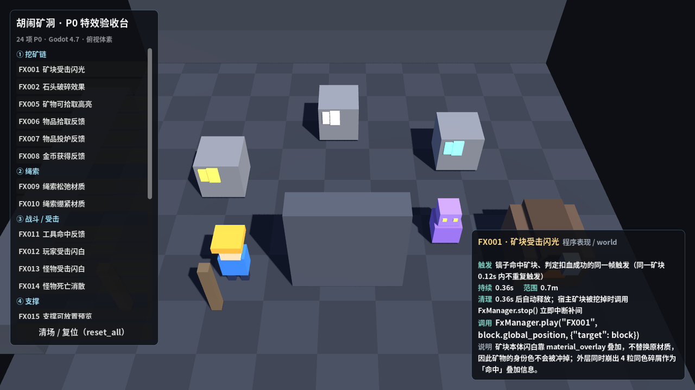

# FX001 矿块受击闪光 · 交付单

| 项 | 内容 |
|---|---|
| 编号 / 优先级 | FX001 · P0 |
| 名称 | 矿块受击闪光 |
| 制作方式 | 程序表现 |
| 类型 | world（world = 世界特效 / target = 贴附跟随 / screen = 全屏层） |
| 持续时间 | 0.36 秒 |
| 作用范围 | 0.7 米（半径） |

## 触发条件
镐子命中矿块、判定扣血成功的同一帧触发（同一矿块 0.12s 内不重复触发）

## 清理条件
0.36s 后自动释放；宿主矿块被挖掉时调用 FxManager.stop() 立即中断补间

## 接入 API
```gdscript
FxManager.play("FX001", block.global_position, {"target": block})
```

## 实现说明
矿块本体闪白靠 material_overlay 叠加，不替换原材质，因此矿物的身份色不会被冲掉；外层同时崩出 4 粒同色碎屑作为「命中」叠加信息。

## 运行时关键帧


## 验收批注
| 检查项 | 结论 | 备注 |
|---|---|---|
| 触发时机与表格一致 | ☐ 通过　☐ 打回 | |
| 持续时间 / 节奏手感 | ☐ 通过　☐ 打回 | |
| 作用范围 / 尺寸 | ☐ 通过　☐ 打回 | |
| 颜色与整体风格统一 | ☐ 通过　☐ 打回 | |
| 同屏多开时的性能 | ☐ 通过　☐ 打回 | |
| 与场景物件的穿插/遮挡 | ☐ 通过　☐ 打回 | |

批注完把本文件发回即可（其他文件不用动）。

## 关联文件
- 实现：`fx/builders/` 或 `fx/scripts/`（见上「接入 API」）
- 规格元数据：`fx/core/fx_specs.gd` 中的 `"FX001"` 条目
- 验收台：`preview/fx_preview.tscn`（全量） / `preview/fx_single.tscn`（单条，改 `fx_id`）
