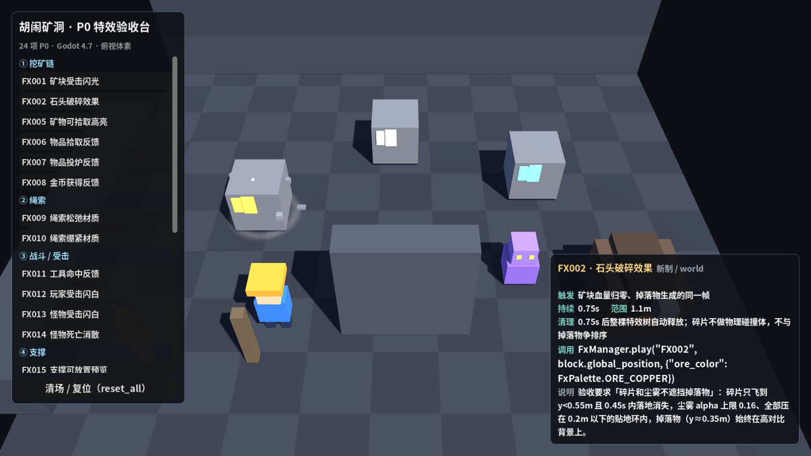

# FX002 石头破碎效果 · 交付单

| 项 | 内容 |
|---|---|
| 编号 / 优先级 | FX002 · P0 |
| 名称 | 石头破碎效果 |
| 制作方式 | 新制 |
| 类型 | world（world = 世界特效 / target = 贴附跟随 / screen = 全屏层） |
| 持续时间 | 0.75 秒 |
| 作用范围 | 1.1 米（半径） |

## 触发条件
矿块血量归零、掉落物生成的同一帧

## 清理条件
0.75s 后整棵特效树自动释放；碎片不做物理碰撞体，不与掉落物争排序

## 接入 API
```gdscript
FxManager.play("FX002", block.global_position, {"ore_color": FxPalette.ORE_COPPER})
```

## 实现说明
验收要求「碎片和尘雾不遮挡掉落物」：碎片只飞到 y<0.55m 且 0.45s 内落地消失，尘雾 alpha 上限 0.16、全部压在 0.2m 以下的贴地环内，掉落物（y≈0.35m）始终在高对比背景上。

## 运行时关键帧


## 验收批注
| 检查项 | 结论 | 备注 |
|---|---|---|
| 触发时机与表格一致 | ☐ 通过　☐ 打回 | |
| 持续时间 / 节奏手感 | ☐ 通过　☐ 打回 | |
| 作用范围 / 尺寸 | ☐ 通过　☐ 打回 | |
| 颜色与整体风格统一 | ☐ 通过　☐ 打回 | |
| 同屏多开时的性能 | ☐ 通过　☐ 打回 | |
| 与场景物件的穿插/遮挡 | ☐ 通过　☐ 打回 | |

批注完把本文件发回即可（其他文件不用动）。

## 关联文件
- 实现：`fx/builders/` 或 `fx/scripts/`（见上「接入 API」）
- 规格元数据：`fx/core/fx_specs.gd` 中的 `"FX002"` 条目
- 验收台：`preview/fx_preview.tscn`（全量） / `preview/fx_single.tscn`（单条，改 `fx_id`）
