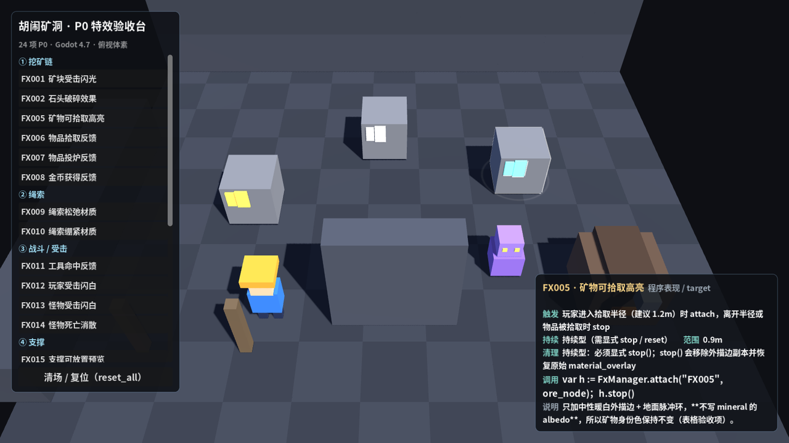

# FX005 矿物可拾取高亮 · 交付单

| 项 | 内容 |
|---|---|
| 编号 / 优先级 | FX005 · P0 |
| 名称 | 矿物可拾取高亮 |
| 制作方式 | 程序表现 |
| 类型 | target（world = 世界特效 / target = 贴附跟随 / screen = 全屏层） |
| 持续时间 | 0.0 秒 |
| 作用范围 | 0.9 米（半径） |

## 触发条件
玩家进入拾取半径（建议 1.2m）时 attach，离开半径或物品被拾取时 stop

## 清理条件
持续型：必须显式 stop()；stop() 会移除外描边副本并恢复原始 material_overlay

## 接入 API
```gdscript
var h := FxManager.attach("FX005", ore_node)；h.stop()
```

## 实现说明
只加中性暖白外描边 + 地面脉冲环，**不写 mineral 的 albedo**，所以矿物身份色保持不变（表格验收项）。

## 运行时关键帧


## 验收批注
| 检查项 | 结论 | 备注 |
|---|---|---|
| 触发时机与表格一致 | ☐ 通过　☐ 打回 | |
| 持续时间 / 节奏手感 | ☐ 通过　☐ 打回 | |
| 作用范围 / 尺寸 | ☐ 通过　☐ 打回 | |
| 颜色与整体风格统一 | ☐ 通过　☐ 打回 | |
| 同屏多开时的性能 | ☐ 通过　☐ 打回 | |
| 与场景物件的穿插/遮挡 | ☐ 通过　☐ 打回 | |

批注完把本文件发回即可（其他文件不用动）。

## 关联文件
- 实现：`fx/builders/` 或 `fx/scripts/`（见上「接入 API」）
- 规格元数据：`fx/core/fx_specs.gd` 中的 `"FX005"` 条目
- 验收台：`preview/fx_preview.tscn`（全量） / `preview/fx_single.tscn`（单条，改 `fx_id`）
