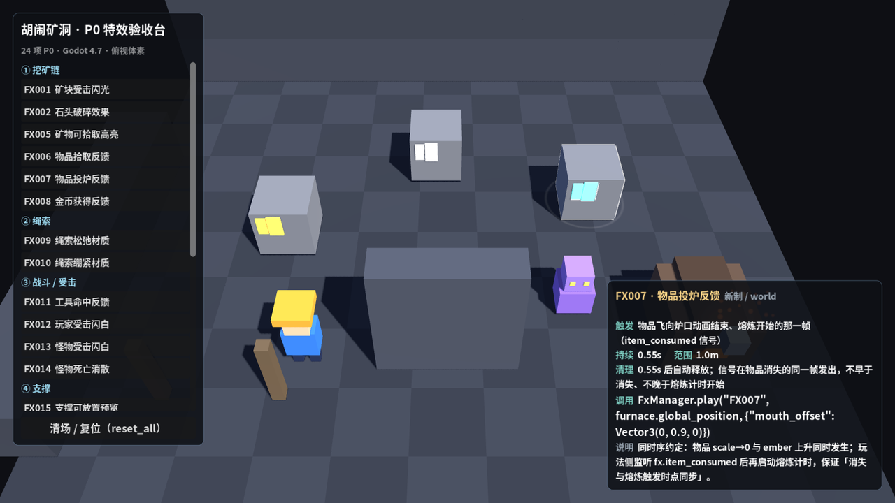

# FX007 物品投炉反馈 · 交付单

| 项 | 内容 |
|---|---|
| 编号 / 优先级 | FX007 · P0 |
| 名称 | 物品投炉反馈 |
| 制作方式 | 新制 |
| 类型 | world（world = 世界特效 / target = 贴附跟随 / screen = 全屏层） |
| 持续时间 | 0.55 秒 |
| 作用范围 | 1.0 米（半径） |

## 触发条件
物品飞向炉口动画结束、熔炼开始的那一帧（item_consumed 信号）

## 清理条件
0.55s 后自动释放；信号在物品消失的同一帧发出，不早于消失、不晚于熔炼计时开始

## 接入 API
```gdscript
FxManager.play("FX007", furnace.global_position, {"mouth_offset": Vector3(0, 0.9, 0)})
```

## 实现说明
同时序约定：物品 scale→0 与 ember 上升同时发生；玩法侧监听 fx.item_consumed 后再启动熔炼计时，保证「消失与熔炼触发时点同步」。

## 运行时关键帧


## 验收批注
| 检查项 | 结论 | 备注 |
|---|---|---|
| 触发时机与表格一致 | ☐ 通过　☐ 打回 | |
| 持续时间 / 节奏手感 | ☐ 通过　☐ 打回 | |
| 作用范围 / 尺寸 | ☐ 通过　☐ 打回 | |
| 颜色与整体风格统一 | ☐ 通过　☐ 打回 | |
| 同屏多开时的性能 | ☐ 通过　☐ 打回 | |
| 与场景物件的穿插/遮挡 | ☐ 通过　☐ 打回 | |

批注完把本文件发回即可（其他文件不用动）。

## 关联文件
- 实现：`fx/builders/` 或 `fx/scripts/`（见上「接入 API」）
- 规格元数据：`fx/core/fx_specs.gd` 中的 `"FX007"` 条目
- 验收台：`preview/fx_preview.tscn`（全量） / `preview/fx_single.tscn`（单条，改 `fx_id`）
