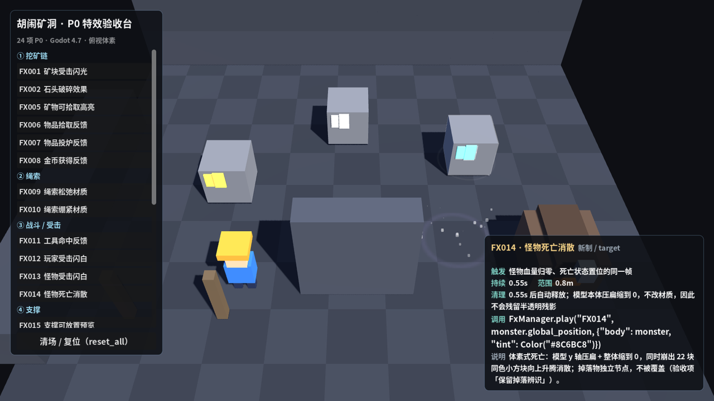

# FX014 怪物死亡消散 · 交付单

| 项 | 内容 |
|---|---|
| 编号 / 优先级 | FX014 · P0 |
| 名称 | 怪物死亡消散 |
| 制作方式 | 新制 |
| 类型 | target（world = 世界特效 / target = 贴附跟随 / screen = 全屏层） |
| 持续时间 | 0.55 秒 |
| 作用范围 | 0.8 米（半径） |

## 触发条件
怪物血量归零、死亡状态置位的同一帧

## 清理条件
0.55s 后自动释放；模型本体压扁缩到 0，不改材质，因此不会残留半透明残影

## 接入 API
```gdscript
FxManager.play("FX014", monster.global_position, {"body": monster, "tint": Color("#8C6BC8")})
```

## 实现说明
体素式死亡：模型 y 轴压扁 + 整体缩到 0，同时崩出 22 块同色小方块向上升腾消散；掉落物独立节点，不被覆盖（验收项「保留掉落辨识」）。

## 运行时关键帧


## 验收批注
| 检查项 | 结论 | 备注 |
|---|---|---|
| 触发时机与表格一致 | ☐ 通过　☐ 打回 | |
| 持续时间 / 节奏手感 | ☐ 通过　☐ 打回 | |
| 作用范围 / 尺寸 | ☐ 通过　☐ 打回 | |
| 颜色与整体风格统一 | ☐ 通过　☐ 打回 | |
| 同屏多开时的性能 | ☐ 通过　☐ 打回 | |
| 与场景物件的穿插/遮挡 | ☐ 通过　☐ 打回 | |

批注完把本文件发回即可（其他文件不用动）。

## 关联文件
- 实现：`fx/builders/` 或 `fx/scripts/`（见上「接入 API」）
- 规格元数据：`fx/core/fx_specs.gd` 中的 `"FX014"` 条目
- 验收台：`preview/fx_preview.tscn`（全量） / `preview/fx_single.tscn`（单条，改 `fx_id`）
