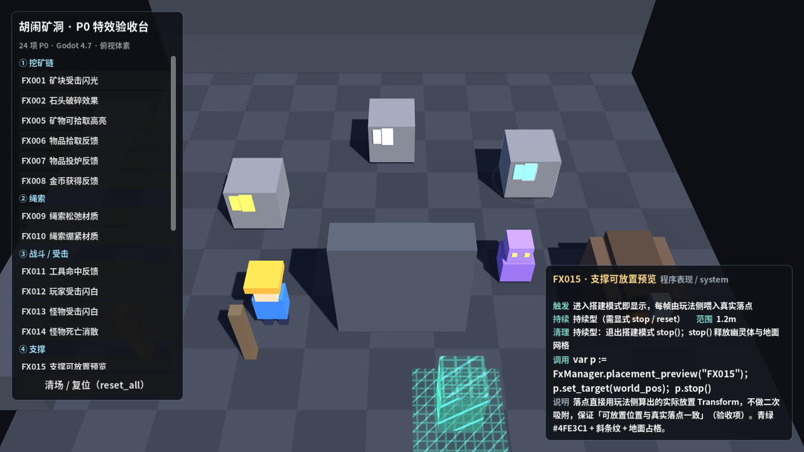

# FX015 支撑可放置预览 · 交付单

| 项 | 内容 |
|---|---|
| 编号 / 优先级 | FX015 · P0 |
| 名称 | 支撑可放置预览 |
| 制作方式 | 程序表现 |
| 类型 | system（world = 世界特效 / target = 贴附跟随 / screen = 全屏层） |
| 持续时间 | 0.0 秒 |
| 作用范围 | 1.2 米（半径） |

## 触发条件
进入搭建模式即显示，每帧由玩法侧喂入真实落点

## 清理条件
持续型：退出搭建模式 stop()；stop() 释放幽灵体与地面网格

## 接入 API
```gdscript
var p := FxManager.placement_preview("FX015")；p.set_target(world_pos)；p.stop()
```

## 实现说明
落点直接用玩法侧算出的实际放置 Transform，不做二次吸附，保证「可放置位置与真实落点一致」（验收项）。青绿 #4FE3C1 + 斜条纹 + 地面占格。

## 运行时关键帧


## 验收批注
| 检查项 | 结论 | 备注 |
|---|---|---|
| 触发时机与表格一致 | ☐ 通过　☐ 打回 | |
| 持续时间 / 节奏手感 | ☐ 通过　☐ 打回 | |
| 作用范围 / 尺寸 | ☐ 通过　☐ 打回 | |
| 颜色与整体风格统一 | ☐ 通过　☐ 打回 | |
| 同屏多开时的性能 | ☐ 通过　☐ 打回 | |
| 与场景物件的穿插/遮挡 | ☐ 通过　☐ 打回 | |

批注完把本文件发回即可（其他文件不用动）。

## 关联文件
- 实现：`fx/builders/` 或 `fx/scripts/`（见上「接入 API」）
- 规格元数据：`fx/core/fx_specs.gd` 中的 `"FX015"` 条目
- 验收台：`preview/fx_preview.tscn`（全量） / `preview/fx_single.tscn`（单条，改 `fx_id`）
