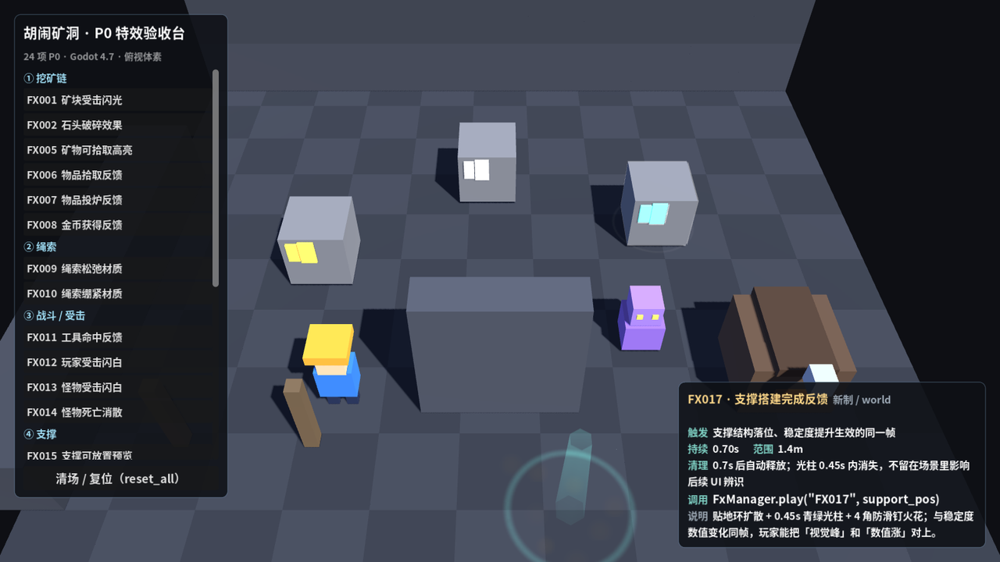

# FX017 支撑搭建完成反馈 · 交付单

| 项 | 内容 |
|---|---|
| 编号 / 优先级 | FX017 · P0 |
| 名称 | 支撑搭建完成反馈 |
| 制作方式 | 新制 |
| 类型 | world（world = 世界特效 / target = 贴附跟随 / screen = 全屏层） |
| 持续时间 | 0.7 秒 |
| 作用范围 | 1.4 米（半径） |

## 触发条件
支撑结构落位、稳定度提升生效的同一帧

## 清理条件
0.7s 后自动释放；光柱 0.45s 内消失，不留在场景里影响后续 UI 辨识

## 接入 API
```gdscript
FxManager.play("FX017", support_pos)
```

## 实现说明
贴地环扩散 + 0.45s 青绿光柱 + 4 角防滑钉火花；与稳定度数值变化同帧，玩家能把「视觉峰」和「数值涨」对上。

## 运行时关键帧


## 验收批注
| 检查项 | 结论 | 备注 |
|---|---|---|
| 触发时机与表格一致 | ☐ 通过　☐ 打回 | |
| 持续时间 / 节奏手感 | ☐ 通过　☐ 打回 | |
| 作用范围 / 尺寸 | ☐ 通过　☐ 打回 | |
| 颜色与整体风格统一 | ☐ 通过　☐ 打回 | |
| 同屏多开时的性能 | ☐ 通过　☐ 打回 | |
| 与场景物件的穿插/遮挡 | ☐ 通过　☐ 打回 | |

批注完把本文件发回即可（其他文件不用动）。

## 关联文件
- 实现：`fx/builders/` 或 `fx/scripts/`（见上「接入 API」）
- 规格元数据：`fx/core/fx_specs.gd` 中的 `"FX017"` 条目
- 验收台：`preview/fx_preview.tscn`（全量） / `preview/fx_single.tscn`（单条，改 `fx_id`）
