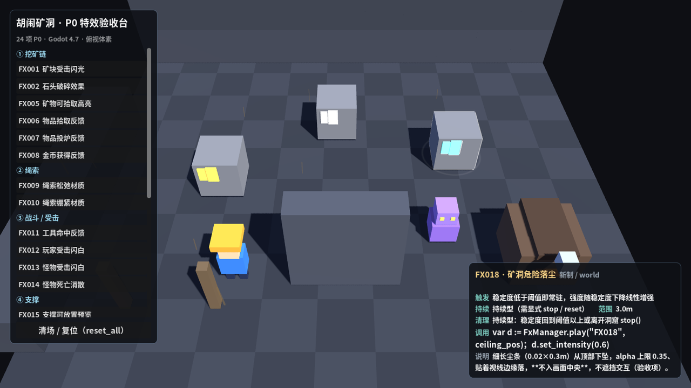

# FX018 矿洞危险落尘 · 交付单

| 项 | 内容 |
|---|---|
| 编号 / 优先级 | FX018 · P0 |
| 名称 | 矿洞危险落尘 |
| 制作方式 | 新制 |
| 类型 | world（world = 世界特效 / target = 贴附跟随 / screen = 全屏层） |
| 持续时间 | 0.0 秒 |
| 作用范围 | 3.0 米（半径） |

## 触发条件
稳定度低于阈值即常驻，强度随稳定度下降线性增强

## 清理条件
持续型：稳定度回到阈值以上或离开洞窟 stop()

## 接入 API
```gdscript
var d := FxManager.play("FX018", ceiling_pos)；d.set_intensity(0.6)
```

## 实现说明
细长尘条（0.02×0.3m）从顶部下坠，alpha 上限 0.35、贴着视线边缘落，**不入画面中央**，不遮挡交互（验收项）。

## 运行时关键帧


## 验收批注
| 检查项 | 结论 | 备注 |
|---|---|---|
| 触发时机与表格一致 | ☐ 通过　☐ 打回 | |
| 持续时间 / 节奏手感 | ☐ 通过　☐ 打回 | |
| 作用范围 / 尺寸 | ☐ 通过　☐ 打回 | |
| 颜色与整体风格统一 | ☐ 通过　☐ 打回 | |
| 同屏多开时的性能 | ☐ 通过　☐ 打回 | |
| 与场景物件的穿插/遮挡 | ☐ 通过　☐ 打回 | |

批注完把本文件发回即可（其他文件不用动）。

## 关联文件
- 实现：`fx/builders/` 或 `fx/scripts/`（见上「接入 API」）
- 规格元数据：`fx/core/fx_specs.gd` 中的 `"FX018"` 条目
- 验收台：`preview/fx_preview.tscn`（全量） / `preview/fx_single.tscn`（单条，改 `fx_id`）
