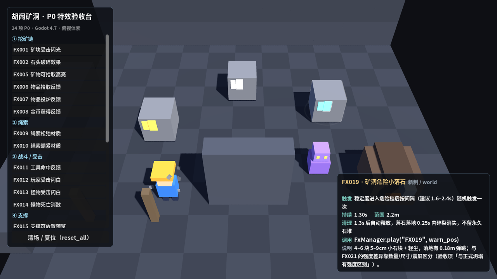

# FX019 矿洞危险小落石 · 交付单

| 项 | 内容 |
|---|---|
| 编号 / 优先级 | FX019 · P0 |
| 名称 | 矿洞危险小落石 |
| 制作方式 | 新制 |
| 类型 | world（world = 世界特效 / target = 贴附跟随 / screen = 全屏层） |
| 持续时间 | 1.3 秒 |
| 作用范围 | 2.2 米（半径） |

## 触发条件
稳定度进入危险档后按间隔（建议 1.6–2.4s）随机触发一次

## 清理条件
1.3s 后自动释放，落石落地 0.25s 内碎裂消失，不留永久石堆

## 接入 API
```gdscript
FxManager.play("FX019", warn_pos)
```

## 实现说明
4–6 块 5–9cm 小石块 + 轻尘，落地有 0.18m 弹跳；与 FX021 的强度差异靠数量/尺寸/震屏区分（验收项「与正式坍塌有强度区别」）。

## 运行时关键帧


## 验收批注
| 检查项 | 结论 | 备注 |
|---|---|---|
| 触发时机与表格一致 | ☐ 通过　☐ 打回 | |
| 持续时间 / 节奏手感 | ☐ 通过　☐ 打回 | |
| 作用范围 / 尺寸 | ☐ 通过　☐ 打回 | |
| 颜色与整体风格统一 | ☐ 通过　☐ 打回 | |
| 同屏多开时的性能 | ☐ 通过　☐ 打回 | |
| 与场景物件的穿插/遮挡 | ☐ 通过　☐ 打回 | |

批注完把本文件发回即可（其他文件不用动）。

## 关联文件
- 实现：`fx/builders/` 或 `fx/scripts/`（见上「接入 API」）
- 规格元数据：`fx/core/fx_specs.gd` 中的 `"FX019"` 条目
- 验收台：`preview/fx_preview.tscn`（全量） / `preview/fx_single.tscn`（单条，改 `fx_id`）
