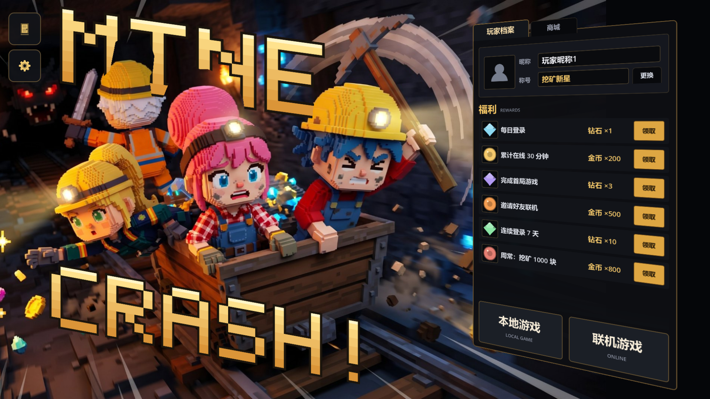

# 准备间（游戏初始主界面）· 交接说明

> 场景：`scenes/ui/lobby.tscn` · 脚本：`scenes/ui/lobby.gd`
> 设计分辨率 1920×1080，与角色选择 / 失败结算界面同一套深色 + 琥珀金配色。

按美术手绘草稿制作：左侧是像素风主视觉（角色 + 透视标题），右侧是一块斜置的控制台。



## 交接内容

- `lobby.tscn` / `lobby.gd` —— 准备间场景与驱动脚本
- `parts/lobby_icon.gd` —— 门 / 齿轮 / 钻石 / 金币 / 头像剪影，代码绘制（`@tool`，编辑器里直接可见）
- `shaders/perspective_warp.gdshader` —— 透视贴合着色器（把矩形贴到任意四边形）
- `assets/ui/backgrounds/lobby_bg.jpg` —— 全屏像素底图
- `assets/ui/title_mine.png` / `title_crash.png` —— 由 `tools/gen_title.py` 生成的两行像素标题
- `assets/ui/backgrounds/lobby_bg_occluder.png` —— 角色遮挡遮罩（让 MINE 被角色挡住），
  由 `tools/gen_lobby_occluder.py` 生成
- `tools/gen_title.py` —— 标题生成器（改字/改色改脚本后重跑即可）
- `tools/gen_lobby_occluder.py` —— 遮挡遮罩生成器（角色轮廓是手描的多边形）

## 节点结构

```
Lobby (Control 1920×1080, lobby.gd)
├── Base (ColorRect)                     兜底深色
├── Backdrop → BgImage (TextureRect)     全屏底图（等比缩放后左移，角色组落在左侧）
├── TitleMine (TextureRect + 着色器)     「MINE」按四边形透视贴合，带角色遮挡遮罩
├── TitleCrash (TextureRect + 着色器)    「CRASH!」按四边形透视贴合
├── PanelViewport (SubViewport 780×1350) 面板内容画在这里
│   └── PanelRoot
│       ├── TabProfile 「玩家档案」/ TabMall 「商城」(z_index=2，压在面板上边框之上)
│       ├── Body (Panel)                 ← 档案页
│       │   ├── ProfileCard (Panel)
│       │   │   ├── AvatarFrame → HeadIcon（头像占位，后期换成真实头像贴图）
│       │   │   ├── NameLabel/NameValue「昵称」
│       │   │   └── TitleLabel/TitleValue「称号」+ BtnBadge「更换」
│       │   ├── SectionTitle「福利」/ SectionSub「REWARDS」
│       │   ├── RewardScroll (ScrollContainer) → RewardList (VBox) → Row 模板
│       │   │   └── HBox: IconSlot(图标占位) / Name(奖励名) / Reward(奖励内容) / Claim(领取)
│       │   ├── ListFade (TextureRect)   列表底部渐隐，遮住被切一半的那一行
│       │   ├── BtnLocal「本地游戏」/ BtnRemote「联机游戏」
│       │   └── …
│       └── MallPage (Panel)             ← 商城页，按要求先留白
├── PanelWarp (TextureRect + 着色器)     控制台按四边形透视贴合
├── BtnExit (88×88)                      「退出」，图标占位
└── BtnSettings (88×88)                  「设置」，图标占位
```

## 透视是怎么做的

Godot 的 Control 只能做仿射变换（旋转/缩放/斜切），做不出真正的梯形透视。
这里的做法是 **渲染 + 单应变换（homography）**：

1. 面板内容画在一个 `SubViewport`（780×1180）里，和普通 UI 一样摆；
2. 脚本算出「单位方形 → 屏幕四边形」的单应矩阵，求逆后把三行系数写进着色器；
3. 着色器对全屏每个像素做一次投影除法，得到纹理 uv，再采样 SubViewport 的纹理；
   落在四边形外的像素输出全透明，所以覆盖层不会挡住别的东西。

因此面板上的文字、按钮、滚动列表都是真正的透视变形，不是「旋转 + 压扁」。

### 四个角在哪改

```gdscript
const PANEL_QUAD := [Vector2(1296, 64), Vector2(1848, 10),    # 左上、右上
                     Vector2(1848, 1058), Vector2(1296, 936)] # 右下、左下
const TITLE_MINE_QUAD  := [Vector2(178, 16),  Vector2(896, 116),
                           Vector2(896, 326), Vector2(178, 226)]
const TITLE_CRASH_QUAD := [Vector2(150, 710), Vector2(1040, 875),
                           Vector2(1040, 1050), Vector2(150, 885)]
```

- 左右两条边保持竖直、右高左低 → 读起来像面板朝右后方转过去（约 30°）；
- 想让倾斜更明显就拉大左右高度差，想更平就减小；
- `PANEL_SIZE`（780×1350）是内容画布尺寸，改四边形宽度时要同步改它，否则内容会被横向拉伸：
  四边形中间高度 ÷ 宽度 = 内容画布的高宽比（960 ÷ 552 ≈ 1.739，780 × 1.739 ≈ 1350）。
- 两行标题各有自己的四边形，斜率保持一致，看起来就像贴在同一个斜面上。

## 面板里的鼠标为什么能点

因为面板是「贴」上去的图，Godot 不知道按钮在哪，所以输入要自己转：

- `screen_to_panel(pos)`：用同一个逆矩阵把屏幕坐标换算成画布坐标（780×1180）；
- `_input()` 里把鼠标移动 / 点击 / 滚轮事件按画布坐标 `push_input()` 进 SubViewport；
- 鼠标移出四边形时补一个「移出」事件，避免按钮卡在 hover 态。

已验证：四个角映射误差 < 0.001px，点击「领取」能正常置灰成「已领取」，页签切换、列表滚动都正常。

## 数据与交互

- 福利数据在 `lobby.gd` 的 `REWARDS`：`name` / `content` / `icon`（0 门 1 齿轮 2 钻石 3 金币 4 头像）/ `color`；
  `count` 为空的行不会出现。列表超出高度自动出现滚动条。
- 「领取」按下后按钮变「已领取」并置灰（占位行为，真实逻辑接这里）。
- 右下两个大按钮、左上两个图标按钮只发信号，**没有绑任何跳转**：

| 信号 | 触发 |
|---|---|
| `exit_requested` | 退出 |
| `settings_requested` | 设置 |
| `local_game_requested` | 本地游戏 |
| `online_game_requested` | 联机游戏 |

```gdscript
$Lobby.local_game_requested.connect(func(): print("开一局本地"))
```

- 玩家档案（头像 / 昵称 / 称号）目前是静态文本，接账号系统时替换 `NameValue/Label`、
  `TitleValue/Label` 的 `text`，头像把 `AvatarFrame/HeadIcon` 换成 `TextureRect` + 贴图。

## 底图与标题

- 底图 `lobby_bg.jpg` 是 1920×1071：脚本按屏高等比缩放（`BG_SCALE`）后左移 `BG_OFFSET`，
  把角色组推到左侧。**没有加任何压暗 / 暗角**，画面就是原图本身，只做了等比缩放 + 平移。
- 标题不是字体，是 `tools/gen_title.py` 画的位图字：改字就改脚本里的 `GLYPHS` / 两个词，
  改颜色改 `TOP_GOLD` / `BOT_GOLD` / `OUTLINE`，然后 `python tools/gen_title.py`。
  每个词出一张「紧贴字形」的 PNG，四边形贴上去就是最终大小。

### 角色挡在 MINE 上面是怎么做的

标题着色器多了一组遮挡参数：`use_occluder` + `occlude_tex` + `occlude_rect`。
遮罩里白色 = 这里被角色占着，片元直接输出全透明，于是字就被"挖掉"了。

- 遮罩 `lobby_bg_occluder.png` 是**按底图原始像素（1920×1071）**画的，只描会被 MINE 扫到的
  三个角色上半身（第四个金发妹子在字的下方，不用遮）；
- `lobby.gd` 的 `_layout_background()` 把底图在屏幕上的位置/尺寸塞进 `occlude_rect`，
  所以改 `BG_OFFSET` / `BG_SCALE` 不用重新生成遮罩；
- 轮廓描松了字会被切在半空中，很难看 —— 改轮廓时用 `tools/gen_lobby_occluder.py` 顺手输出的
  `.godot/occluder_check.png`（半透明白 + 绿边叠在底图上）核对。

## 已知限制（需要的话可以继续做）

- 面板内只转发了鼠标，**键盘焦点 / Tab 键 / 输入法**没有桥接（当前界面没有输入框，够用）；
- 窗口用了 `canvas_items + expand` 拉伸，超宽屏时右侧会多出画面，面板不会跟着贴到最右边
  （要贴边就把 `PANEL_QUAD` 的 x 改大，或改成按窗口宽度算）；
- 标题现在会被角色遮住；如果想让字露出来更多，把 `TITLE_MINE_QUAD` 整体上移或缩小即可。
- 面板已经贴到屏幕右侧（x 到 1848），最右边留了 72px 底图边（底图左移后右侧本来就不够宽），
  真机全屏时看起来就是一条暗边；要彻底消掉就给底图加一块镜像延长，或把面板拉到 1920。
