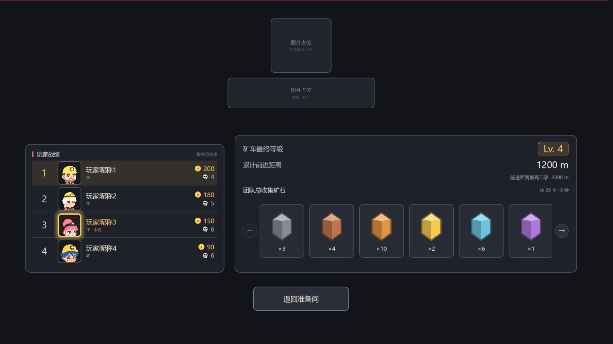
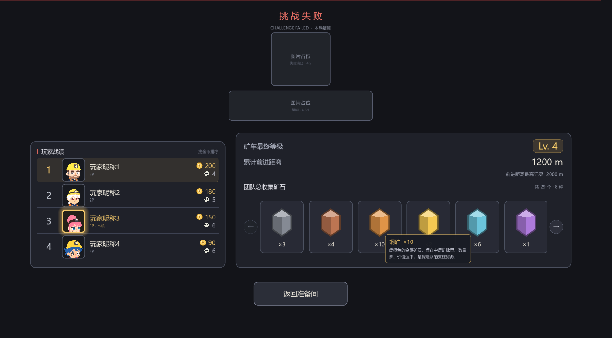

# 失败结算界面 - 占位场景交接说明

按美术手绘草稿制作，1920×1080。上半部分两张图片占位（失败演出 / 横幅），
左下 4 人结算排行榜，右下团队整体结算（矿车等级、距离、矿石收集、可左右滚动），
底部「返回准备间」。





## 交接内容

| 文件 | 说明 |
|---|---|
| `scenes/ui/result_fail.tscn` | 界面场景（Godot 4.6，1920×1080） |
| `scenes/ui/result_fail.gd` | 占位脚本：填数据 / 渲染头像 / 生成矿石槽 / 滚动 / 返回 |
| `scenes/ui/parts/result_icon.gd` | 金币、骷髅、矿石晶体三个小图标（`@tool`，编辑器里直接可见） |
| `Docs/images/失败结算界面-预览.png` | 渲染截图 |

## 场景结构

```
ResultFail (Control，全屏 1920×1080，CJK 字体主题，挂 result_fail.gd)
├── Background (ColorRect)                深色底 #131419
├── PortraitPool (Node)                   4 个头像的 SubViewport 挂在这里（脚本创建）
├── TopBand (ColorRect)                   顶部 4px 暗红条
├── TopImages (Control)                   x 660~1260, y 40~346（原「挑战失败」标题已按要求移除）
│   ├── SlotA (PanelContainer 190×170)    「图片占位」失败演出 4:5
│   └── SlotB (PanelContainer 460×96)     「图片占位」横幅 4.6:1
├── Board (PanelContainer)                排行榜卡片 x 96~720, y 452~856
│   └── Margin → VBox
│       ├── Head                          红竖条 +「玩家战绩」+「按金币排序」
│       └── Row1 ~ Row4 (PanelContainer 高 78)
│           └── HBox
│               ├── Rank (Label 宽 56)    名次，第 1 名金色
│               ├── Portrait (74×74)      角色头像框，本机玩家 = 金色粗框 + 外发光
│               ├── NameBox               昵称（21px）+ 玩家位（12px，如「3P」）
│               └── Stats (宽 132)        金币行（金币图标 + 数字）/ 死亡行（骷髅 + 数字）
├── TeamPanel (PanelContainer)            团队结算卡片 x 752~1824, y 424~856
│   └── Margin → VBox
│       ├── LvRow     「矿车最终等级」 …… LvPill「Lv. 4」（金色胶囊）
│       ├── DistRow   「累计前进距离」 …… 「1200 m」
│       ├── BestRow   「前进距离最高记录  2000 m」（右对齐小字）
│       ├── HSep      1px 分隔线
│       ├── OreHead   「团队总收集矿石」 …… 「共 29 个 · 8 种」
│       └── OreWrap (Control)
│           ├── OreScroll (ScrollContainer 高 176，左右各留 52 给箭头)
│           │   └── OreRow (HBox) → 脚本按数据克隆 Template
│           │       └── Template (140×168，隐藏；图标 108 + 数量「×3」)
│           ├── BtnOreLeft  「←」44×44 圆形
│           └── BtnOreRight 「→」44×44 圆形
└── BtnBack (Button 300×76)               「返回准备间」x 810~1110, y 900~976
```

## 数据接入（改这三个常量即可）

`result_fail.gd` 顶部，正式接入时换成从对局数据里读，节点结构不用动。

```gdscript
PLAYERS = [
    {"rank": 1, "name": "寸头哥", "tag": "3P", "coin": 200, "death": 4, "char": 0, "is_main": false},
    ...
]
```

| 字段 | 含义 |
|---|---|
| `rank` | 名次，直接显示；第 1 名自动金色 |
| `name` | **玩家自己的昵称**（占位是「玩家昵称1~4」，不是角色名）；程序接入时换成真实昵称 |
| `tag` | 玩家位（3P / 2P …），本机会自动追加「· 本机」 |
| `coin` / `death` | 金币数 / 死亡次数 |
| `char` | 角色模型下标 0~5，对应 `CHAR_MODELS`（与 `character_select.gd` 同一套顺序） |
| `is_main` | 本机玩家 → 头像金框 + 昵称金色 |

```gdscript
TEAM = {"cart_level": 4, "distance": 1200, "best": 2000}
ORES = [{"name": "煤矿", "color": Color(...), "count": 3, "desc": "悬浮窗文案"}, ...]
```

- `ORES` 里 `count = 0` 的种类**不会显示**；「共 N 个 · M 种」由数据自动算；
- `desc` 是矿石悬浮窗里的介绍文案（目前是占位文案，接配置表时替换）；
- 矿石图标是代码画的六边形晶体，颜色取 `color`；换成美术图时把 `Template/VBox/Icon`
  这个 Control 换成 TextureRect 即可（脚本按 `find_child("Icon")` 找，名字别改）；
- 队伍人数不是 4 人时，删/加 `Row1~Row4` 节点，并同步 `PLAYERS` 条数
  （脚本按 `Row%d` 命名找节点，从 1 开始）。

## 角色头像怎么来的

没有现成的头像贴图，所以**用 3D 模型实时渲染头部特写**，不用美术另出图：

- 每个玩家一个 `SubViewport`（192×192，透明背景），创建在 `PortraitPool` 下；
- 相机取景是**按模型包围盒自适应**的：`_model_aabb()` 量出头顶与身高，
  画面中心放在「头顶往下 20.5% 身高」处，视野高度取 68% 身高（正好装下头 + 一点肩）
  ——6 个角色帽子高低不同，写死一个固定取景一定会有人被裁，所以走自适应；
- 模型旋转 `MODEL_YAW + 0.36`（≈ 20° 侧脸，比正脸死板好）；
- 渲染 2 帧后把 `render_target_update_mode` 切成 `UPDATE_ONCE`，**之后不再占 GPU**；
- 想换成 2D 头像贴图：把 `_make_portrait()` 换成
  `holder` 里塞一个 `TextureRect`（`stretch_mode = KEEP_ASPECT_COVERED`）即可，
  其它代码不用动。

## 矿石左右滚动

- 原生滚动条**已隐藏**（`horizontal_scroll_mode = 3`），靠两侧圆形箭头 + 鼠标滚轮导航；
- 箭头点击滚 0.6 屏，`create_tween` 0.22s 缓动；
- 滚到两端时对应箭头 `disabled`（有自己的暗态样式，箭头仍可见但不响应）；
- 内容宽度由槽位自动撑开，矿石数量变化不用改布局。

## 矿石悬浮窗

- 鼠标停在矿石槽上，浮出一个跟随鼠标的暗色小卡：**矿石名 ×数量** + 一句介绍文案；
- 实现在 `_build_ore_tip()`（节点运行时生成，挂在根节点最后，`z_index = 100` 保证在最上层）；
- 显示/隐藏/跟手由 `_process` → `_update_ore_hover()` 每帧做**矩形命中检测**，
  不依赖 `mouse_entered` 信号（滚动、窗口失焦时也不会漏）；
- 位置默认在鼠标右下 18/24 px，靠近屏幕右/下边缘时自动翻到左侧/上方，不会出屏；
- 文案取自 `ORES[i].desc`，改文案只改数据区；想改宽度改 `_tip_desc.custom_minimum_size`。

## 返回准备间

- `BtnBack.pressed` → `_on_back_pressed()`：只 `back_requested.emit()` 发信号，
  **不做任何场景跳转**；
- 准备间界面做好后，由外部代码连接 `back_requested` 信号（或调用
  `change_scene_to_file`）来接管跳转逻辑。

## 还是占位的部分

1. 上方两个「图片占位」框 —— 等失败演出图 / 横幅插画，替换 `SlotA` `SlotB` 的
   内部 VBox 为 TextureRect 即可（框尺寸不用改）；
2. 金币 / 骷髅 / 矿石图标 —— 目前是 `result_icon.gd` 用代码画的，风格统一但不精细；
   美术图到位后换成 TextureRect，尺寸建议 22（金币/骷髅）/ 108（矿石）；
3. `PLAYERS` / `TEAM` / `ORES` 全是假数据；
4. 「失败」氛围只做了配色（暗红标题 + 顶部红条），没有动效；如需淡入 / 数字滚动，
   再单独加 Tween。

## 备注

- 全部用绝对坐标（`offset_*`）排的版，按 1920×1080 设计；项目已配置
  `stretch/mode=canvas_items` + `aspect=expand`，换分辨率整体缩放不会错位；
- 卡片、行、头像框的样式都在 tscn 的 `StyleBoxFlat` 子资源里，颜色随时可调；
- 与角色选择界面共用同一套配色：卡片底 `#20222A`、金色 `#F5C460`、次要文字 `#8A8C93`。
